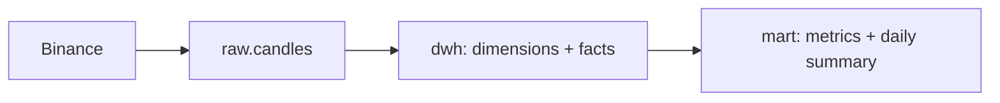

# Crypto Data Platform

A small, repeatable data pipeline that loads closed hourly Binance candles into PostgreSQL, transforms them into a dimensional warehouse, checks data quality, and refreshes reporting marts.



## Run from a clean checkout

1. Copy `.env.example` to `.env` and set a local PostgreSQL password. Start the database from the repository root:

   ```powershell
   Copy-Item .env.example .env
   docker compose up -d
   ```

2. Create the raw table, install the Python dependencies, and load recent closed candles:

   ```powershell
   Get-Content -Raw sql/001_raw_schema.sql | docker compose exec -T crypto_db psql -U crypto -d crypto
   python -m pip install -r requirements.txt
   python src/load_candles.py
   ```

3. Run `sql/002_dwh_schema.sql`, then `sql/003_load_dwh.sql`, then `sql/004_mart.sql` in that order. They create the DWH, load valid candles, and create and initially populate the marts. For example:

   ```powershell
   Get-Content -Raw sql/002_dwh_schema.sql | docker compose exec -T crypto_db psql -U crypto -d crypto
   Get-Content -Raw sql/003_load_dwh.sql | docker compose exec -T crypto_db psql -U crypto -d crypto
   Get-Content -Raw sql/004_mart.sql | docker compose exec -T crypto_db psql -U crypto -d crypto
   ```

4. Copy `airflow/.env.example` to `airflow/.env`, set unique local passwords and a Fernet key, and URL-encode the database password in `AIRFLOW_CONN_CRYPTO_PG`. A Fernet key can be generated with:

   ```powershell
   python -c "import base64, os; print(base64.urlsafe_b64encode(os.urandom(32)).decode())"
   ```

   Start Airflow from its directory after the root database is running:

   ```powershell
   Copy-Item airflow/.env.example airflow/.env
   Push-Location airflow
   docker compose up -d
   Pop-Location
   ```

   Open [http://localhost:8080](http://localhost:8080), sign in with the credentials from `airflow/.env`, change the initial Airflow password through the Security menu, and enable `crypto_candles_hourly`. It runs at minute 5 of each hour. The browser port is bound to localhost.

## Pipeline and SQL files

- `001_raw_schema.sql` creates the raw landing table.
- `002_dwh_schema.sql` creates the symbol/date dimensions and candle fact table.
- `003_load_dwh.sql` loads dimensions and valid hourly facts in one transaction.
- `004_mart.sql` creates the live candle metrics view and initially populates the daily materialized view. Run this manually when creating the marts.
- `005_refresh_marts.sql` refreshes the daily mart concurrently after a successful quality check.
- `006_dq_checks.sql` checks recent raw rows and DWH freshness. A failed check prevents the mart refresh.

The DAG runs `load_raw_candles → load_dwh → dq_checks → refresh_marts`. Raw candles use an upsert on `(symbol, candle_interval, open_time)`; DWH loads use conflict handling on their natural keys. Retrying a completed load therefore updates the same candle rows instead of duplicating them.

Keep `.env` and `airflow/.env` private. Their example files contain placeholders only.
